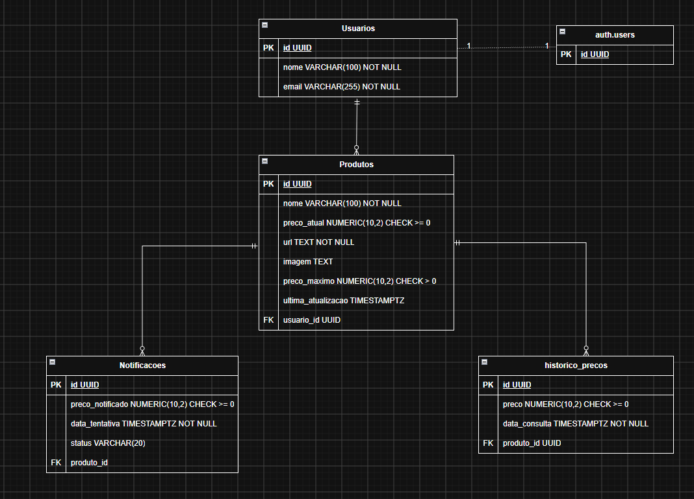

# Arquitetura Inicial — Price Watcher

Este documento apresenta uma visão inicial da arquitetura do Price Watcher.
A arquitetura poderá evoluir durante o desenvolvimento do projeto.

## Frontend

Responsável pela interface utilizada pelo usuário.

Principais responsabilidades:

- exibir os produtos monitorados;
- permitir o cadastro de produtos;
- permitir a definição de um preço máximo;
- exibir o preço atual e o status do monitoramento;
- permitir editar, pausar ou excluir produtos;
- apresentar mensagens de sucesso e erro.

## Backend

Responsável pelo processamento das regras do sistema.

Principais responsabilidades:

- receber e processar os dados enviados pelo frontend;
- gerenciar usuários e produtos monitorados;
- realizar as verificações periódicas de preço;
- obter o preço atual dos produtos monitorados;
- comparar o preço atual com o preço máximo definido;
- registrar o histórico de preços;
- determinar quando um alerta deve ser enviado;
- solicitar o envio das notificações por e-mail.

A forma de obtenção dos preços do Mercado Livre ainda será definida durante
o desenvolvimento, podendo envolver uma API ou a coleta de informações
disponíveis na página do produto.

## Banco de Dados

Responsável por armazenar permanentemente os dados necessários para o
funcionamento do sistema.

Entre os dados armazenados estão:

- informações dos usuários;
- produtos monitorados;
- URLs dos produtos;
- preços máximos definidos;
- status dos monitoramentos;
- histórico das verificações de preço.

A estrutura atual do banco de dados é composta por quatro tabelas principais:

- `usuarios`: armazena os dados de perfil dos usuários;
- `produtos`: armazena os produtos monitorados e seus preços;
- `historico_precos`: registra os preços observados ao longo do tempo;
- `notificacoes`: registra as tentativas de notificação relacionadas aos produtos.

As tabelas utilizam chaves primárias e estrangeiras para identificar os registros e manter os relacionamentos entre os dados.

O banco de dados está hospedado no Supabase, no projeto **Estom**. O PostgreSQL é utilizado para armazenar os dados estruturados da aplicação.

;

## Scripts SQL

Os scripts SQL do projeto estão organizados na pasta `sql/` e devem ser executados na seguinte ordem em uma configuração inicial do banco:

1. `01_schema.sql` — cria as tabelas, chaves e restrições do banco de dados.
2. `02_seed.sql` — insere dados fictícios para testes.
3. `03_queries.sql` — contém consultas de demonstração utilizando os dados inseridos.
4. `04_policies.sql` — habilita as políticas de leitura utilizadas para restringir o acesso aos registros.

Os scripts de dados e políticas devem ser utilizados considerando o estado do banco e as instruções de cada arquivo. Para validar a reprodução do projeto, os scripts devem ser executados em um banco de testes vazio, na ordem adequada.

## Segurança e autenticação

O banco de dados utiliza PostgreSQL hospedado no Supabase.

A autenticação dos usuários será gerenciada pelo Supabase Auth. A tabela `usuarios` armazena os dados de perfil e utiliza um identificador relacionado ao usuário de autenticação.

O Row Level Security (RLS) está habilitado nas tabelas `usuarios`, `produtos`, `historico_precos` e `notificacoes`, com políticas de leitura destinadas a restringir o acesso aos dados de cada usuário autenticado.

As políticas ainda deverão ser validadas com diferentes sessões de usuários, e as permissões de escrita serão definidas conforme a implementação do backend.

As políticas de leitura foram testadas com duas contas autenticadas no Supabase, verificando o isolamento dos registros nas quatro tabelas. As permissões de escrita ainda serão definidas conforme a implementação do backend.

## Estado atual da implementação

A estrutura do banco de dados foi criada no Supabase, incluindo as quatro tabelas principais, suas chaves e restrições, além das políticas iniciais de leitura.

As consultas SQL de demonstração e os dados fictícios são utilizados para validar o modelo.

A integração completa entre frontend e banco, a coleta automática de preços e o envio de notificações por e-mail permanecem como etapas futuras do desenvolvimento.

## Serviços externos

### Mercado Livre

Fonte das informações dos produtos monitorados, incluindo o preço atual.

### Serviço de e-mail

Responsável pela entrega dos alertas de preço aos usuários.

## Visão geral

**Fluxo planejado do sistema**

Usuário  
↓  
Frontend  
↓  
Backend  
├── Banco de Dados (PostgreSQL/Supabase)  
├── Mercado Livre  
└── Serviço de e-mail

O frontend é responsável pela interação com o usuário. O backend será responsável pelo processamento das regras do sistema, pela consulta de preços e pelo acesso aos dados persistidos no banco.

Este fluxo representa a arquitetura planejada. A integração completa entre esses componentes será implementada nas próximas etapas do projeto.